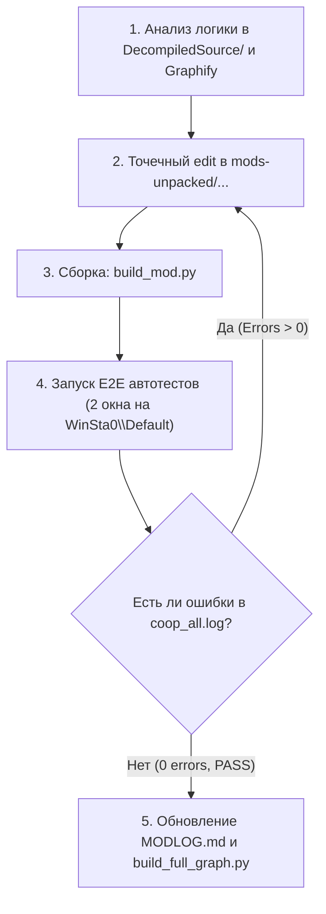

# ТЕХНИЧЕСКАЯ АРХИТЕКТУРА И СПЕЦИФИКАЦИЯ: COOPANYTHING-BROTATOONLINE

> **Статус документа:** Актуален для версии Brotato v1.1.15.1 + DLC Abyssal Terrors  
> **Стек технологий:** Godot Engine 3.5.x (Custom Brotato build), GodotModLoader 6.3.0, NetworkedMultiplayerENet (UDP)  
> **Репозиторий проекта:** https://github.com/Aldiyuar/CoopAnything-BrotatoOnline  

---

## 1. НАЗНАЧЕНИЕ И ЦЕЛЬ МОДА

Оригинальная игра **Brotato** поддерживает исключительно локальный кооператив за одним компьютером (Same-PC Couch Co-op с разделением контроллеров).  
Мод **CoopAnything-BrotatoOnline** преобразует локальный кооператив в полноценный сетевой онлайн-мультиплеер без использования сторонних коммерческих сервисов, опираясь на встроенный в движок Godot стек `NetworkedMultiplayerENet` (UDP сокеты, по умолчанию порт 7777).

### Ключевые возможности:
- Прямое сетевое подключение Хост-Клиент (LAN / VPN / Белый IP / Playit.gg) на UDP-порту 7777.
- Строгая **Host-Authoritative модель** (Хост — абсолютный источник истины для физики, спавна мобов, волн, лута и урона).
- Прозрачная интеграция в нативный движок Brotato через виртуальные девайсы `100+` в `CoopService`.
- Исключение двойного урона (Double Damage Fix) — физический расчет оружия Хостом и визуальная обратная связь на Клиенте.
- Синхронизация движения с частотой 20 Hz и плавная 60 FPS интерполяция на Клиенте без rubberbanding.
- Полная репликация смертей, спектэйтор и синхронный GameOver при вайпе команды.
- Синхронный наземный дроп (First-Come, First-Served: монеты, ящики, плоды забирает первый коснувшийся).
- Независимый сплит-магазин, раздельный баланс золота, выбор статов при левелапе, открытие ящиков и атомарный переход на следующую волну.
- Изоляция сохранений Клиента в `user://GOG-Saves-Client` для защиты локальных файлов Хоста.

---

## 2. СТРУКТУРА ОКРУЖЕНИЯ И ПАПОК

В проекте используются **строго две папки** на диске `D:\`:

```
D:\
├── Brotato_Project\                 <-- 1. ПАПКА РАЗРАБОТКИ (РЕДАКТИРУЕМ ТОЛЬКО ЗДЕСЬ)
│   ├── mods-unpacked\
│   │   └── CoopAnything-BrotatoOnline\  <-- Исходный код мода на GDScript
│   ├── DecompiledSource\            <-- Распакованный код базовой игры (поиск оригинальных функций)
│   ├── DecompiledSource_DLC\        <-- Распакованный код DLC Abyssal Terrors
│   ├── tools\                       <-- Скрипты сборки, E2E автотестов и графа знаний
│   ├── graphify-out\                <-- Граф архитектуры (AST knowledge graph)
│   ├── MODLOG.md                    <-- Инженерный журнал подтвержденного функционала
│   ├── MOD_ARCHITECTURE.md          <-- Этот документ (генеральная спецификация)
│   ├── PROMPT_ONBOARDING_DEVELOPER.md <-- Промпт для подключения нового AI к проекту
│   └── PROMPT_FULL_AUDIT.md         <-- Промпт для глубокого независимого аудита мода
│
└── Brotato_Coop_Test\               <-- 2. ТЕСТОВЫЙ РАНТАЙМ (СЮДА ТОЛЬКО ДЕПЛОИМ И ЗАПУСКАЕМ)
    ├── Brotato.exe                  <-- Исполняемый файл игры
    ├── mods\                        <-- Папка, куда build_mod.py помещает собранный zip мода
    ├── logs\coop_all.log            <-- Единый лог сетевого взаимодействия
    └── screenshots\                 <-- Скриншоты реальных игровых сессий
```

---

## 3. ПОЛНЫЙ КАТАЛОГ И НАЗНАЧЕНИЕ ФАЙЛОВ МОДА

Все файлы мода расположены по пути: `D:\Brotato_Project\mods-unpacked\CoopAnything-BrotatoOnline\`

| Файл | Назначение и ключевая ответственность |
|---|---|
| `manifest.json` | Метаданные мода: id `CoopAnything-BrotatoOnline`, версия 1.0.0, зависимости ModLoader 6.3.0. |
| `mod_main.gd` | Точка входа ModLoader: установка расширений скриптов через `ModLoaderMod.install_script_extension` и внедрение синглтона `NetworkManager` в дерево сцен (`root`). |
| `global/network_constants.gd` | Константы порта (`DEFAULT_PORT = 7777`), роли узла (`PeerRole.HOST`, `PeerRole.CLIENT`, `PeerRole.SOLO`), лимиты игроков. |
| `global/network_logger.gd` | Потокобезопасное логирование с меткой времени, PID процесса и уровнем важности (`[INFO]`, `[SUCCESS]`, `[WARN]`, `[ERROR]`), вывод в консоль и `coop_all.log`. |
| `global/network_manager.gd` | **Ядро сетевого стека**: управление ENet (`NetworkedMultiplayerENet`), обработка всех входящих/исходящих RPC, батчинг позиций и мобов, CLI-сценарии тестов, изоляция сохранений. |
| `extensions/singletons/coop_service.gd` | Переопределение нативного `CoopService`: создание виртуальных устройств `100+` для сетевых игроков, обход проверок `FocusEmulator`, инициализация 4 слотов. |
| `extensions/entities/units/movement_behaviors/player_movement_behavior.gd` | Хук движения игрока: считывание локального ввода (или синтетического в тестах), стриминг инпута Клиента Хосту, мгновенная остановка (`Vector2.ZERO`) при гибели. |
| `extensions/main.gd` | **Хук боевой арены**: отключение локального `WaveManager` на Клиенте, спавн общих мобов и деревьев на Хосте, рассылка батчей (20 Hz), покадровая 60 FPS интерполяция на Клиенте, защита `_cleaning_up`, наземный лут, перехват смертей `_on_player_died`. |
| `extensions/ui/menus/shop/coop_shop.gd` | Сетевой сплит-магазин: раздельные витрины для каждого игрока, независимые покупки из личного золота, реролл через RPC, блокировка витрины и переход на следующую волну только при взаимной готовности (`Ready`). |
| `extensions/ui/menus/ingame/upgrades_ui.gd` | Межволновой интерфейс: открытие ящиков и выбор статов игроками без дедлоков; передача управления Хосту для смены сцены. |
| `extensions/ui/menus/ingame/retry_wave.gd` | Перехват `_change_scene` в окне вайпа: трансляция выбора Хоста на Клиент для синхронного перехода в `coop_end_run.tscn`. |
| `extensions/ui/menus/ingame/pause_menu.gd` | Подавление автоматической паузы при потере окном фокуса ввода (`_on_game_lost_focus`), чтобы игра не замирала у одного из игроков. |
| `extensions/ui/menus/pages/main_menu.gd` | Внедрение кнопки «Онлайн Кооператив» в главное меню игры. |
| `ui/online_dialog.gd` | Графический диалог ввода IP-адреса, порта и выбора роли (Создать сервер / Подключиться). |

---

## 4. ДЕТАЛЬНОЕ УСТРОЙСТВО СЕТЕВЫХ ПОДСИСТЕМ

### 4.1. Архитектура подключения и эмуляция устройств (CoopService)
- Хост вызывает `_enet_peer.create_server(7777, 4)`.
- Клиент вызывает `_enet_peer.create_client(ip, 7777)`.
- Brotato в оригинале определяет игроков по номерам физических устройств (`device: 0..3`).
- В моде синглтон [coop_service.gd](file:///D:/Brotato_Project/mods-unpacked/CoopAnything-BrotatoOnline/extensions/singletons/coop_service.gd) переопределяет нативный класс:
  - Локальный игрок получает нативный физический девайс (`0`).
  - Сетевые игроки получают виртуальные девайсы: `100 + player_index` (для Клиента 1 это `101`).
  - Физический движок игры видит куклу удаленного игрока как полноценного участника кооператива с нативными статами, хитбоксами и инвентарем.

### 4.2. Боевая система и исключение двойного урона (Double Damage Fix)
- **Проблема в наивной реализации:** Если и Хост, и Клиент считают урон своего оружия, мобы получают двойной урон (локальный хит + RPC хит).
- **Решение мода:**
  - Оружие обоих игроков физически симулируется **только на Хосте** (кукла Клиента `_players[1]` экипирована оружием и стреляет по его сетевому инпуту).
  - Клиент локально воспроизводит анимации, всплывающий текст и звуки попаданий для отзывчивости, но **никогда не шлет RPC-урон на Хост** (`rpc_client_dealt_damage` является заглушкой).
  - В [extensions/main.gd](file:///D:/Brotato_Project/mods-unpacked/CoopAnything-BrotatoOnline/extensions/main.gd) в методе `_on_enemy_took_damage` на Клиенте стоит защита: локальный урон не может убить моба (`health = 1, dead = false`), если от Хоста не пришел флаг `host_killed`.
  - Авторитетное здоровье мобов рассылается Хостом 20 раз в секунду через `rpc_sync_enemy_batch`.

### 4.3. Синхронизация движения и покадровая 60 FPS интерполяция
- Хост рассылает батчи позиций игроков `rpc_sync_player_positions` с тикрейтом 20 Hz (каждые 50 мс).
- **Устранение Rubberbanding:**
  - На Хосте в `rpc_send_player_input`: порог коррекции куклы увеличен до `150.0 / 300.0`. Хост доверяет своей физической симуляции ввода и не тянет куклу назад к устаревшим RTT-координатам Клиента.
  - На Клиенте в `rpc_sync_player_positions`: для локального игрока порог коррекции поднят до `180.0 / 350.0`. При штатном пинге локальное предсказание полностью исключает дергания персонажа назад.
- **Интерполяция 60 FPS:**
  - Пакеты 20 Hz сохраняют целевую позицию в метаданных: `set_meta("net_target_pos", target_pos)`.
  - В `extensions/main.gd::_physics_process(delta)` на Клиенте каждый физический кадр (60 раз в секунду) выполняется:
    ```gdscript
    var weight = clamp(delta * 16.0, 0.0, 1.0)
    entity.global_position = entity.global_position.linear_interpolate(target, weight)
    ```
  - Это обеспечивает абсолютно плавный рендеринг движения мобов и удаленного игрока без ступенек.

### 4.4. Защита межволнового перехода (`_cleaning_up`)
- Во время перехода волны и зачистки арены (`_cleaning_up = true`):
  - Подавлен спавн новых врагов и деревьев (`_network_register_enemy`, `_network_register_neutral`).
  - Подавлена генерация наземного дропа (`spawn_gold`, `spawn_consumables`).
  - Отключена рассылка индивидуальных `rpc_enemy_died` при зачистке мобов в конце волны.
  - На Клиенте очищаются очереди призыва `queue_to_spawn_summons` и `queue_to_spawn_trees`.
  - При смене сцены через `rpc_sync_change_scene` словари `network_enemies` и `ground_items` гарантированно очищаются на обеих сторонах.

### 4.5. Наземный лут (First-Come, First-Served)
- Хост авторитетно спавнит монеты и ящики с точными векторами отскока (`rpc_spawn_ground_gold`, `rpc_spawn_ground_consumable`).
- Предмет подбирает тот игрок, который первым физически коснулся его хитбокса.
- При касании предмет локально скрывается, на Хост отправляется запрос `rpc_request_item_pickup`, Хост начисляет золото/опыт подорвавшему игроку и удаляет предмет у всех через `rpc_remove_ground_item`.

### 4.6. Сплит-магазин и выбор характеристик
- В конце волны вызывается `CoopUpgradesUI` (`res://ui/menus/ingame/upgrades_ui.tscn`), где игроки параллельно открывают свои ящики и выбирают характеристики.
- Клиент ожидает завершения выбора Хоста, после чего Хост централизованно меняет сцену на `res://ui/menus/shop/coop_shop.tscn`.
- В магазине:
  - Каждый игрок покупает предметы за личное золото.
  - Клиент запрашивает покупки через `rpc_request_shop_buy(player_index, slot)`.
  - Клиент запрашивает реролл через `rpc_request_shop_reroll(player_index)`. Хост генерирует новые товары и синхронизирует их обратно через `rpc_confirm_shop_reroll`.
  - Переход на следующую боевую волну происходит только при нажатии кнопки «Готов» (`Ready`) обоими игроками.

---

## 5. ИНЖЕНЕРНЫЙ ЦИКЛ РАЗРАБОТКИ И ТЕСТИРОВАНИЯ (TDD)

Каждое изменение в моде подчиняется строгому 4-шаговому циклу:



### Команды для работы в терминале:

1. **Сборка и развертывание мода:**
   ```powershell
   python "D:\Brotato_Project\tools\build_mod.py" "D:\Brotato_Coop_Test"
   ```

2. **Запуск автоматических тестов с двумя окнами игры:**
   - **Тест боевой арены (мобы, лут, стрельба, синхронизация):**
     ```powershell
     python "D:\Brotato_Project\tools\real_game_arena_test.py"
     ```
   - **Тест гибели, спектэйтора и GameOver при вайпе:**
     ```powershell
     python "D:\Brotato_Project\tools\real_game_death_test.py"
     ```
   - **Тест сундуков, статов, магазина и перехода к волне 2:**
     ```powershell
     python "D:\Brotato_Project\tools\real_game_postwave_test.py"
     ```

3. **Обновление графа знаний Graphify:**
   ```powershell
   python "D:\Brotato_Project\tools\build_full_graph.py"
   ```

4. **Критерий успешности изменений:**
   - Лог `D:\Brotato_Coop_Test\logs\coop_all.log` содержит **строго 0 [ERROR]** и 0 Parse Error.
   - Все контрольные майлстоуны скрипта имеют статус `[PASS]`.
   - На экране пользователя в процессе теста открываются два видимых окна игры.
